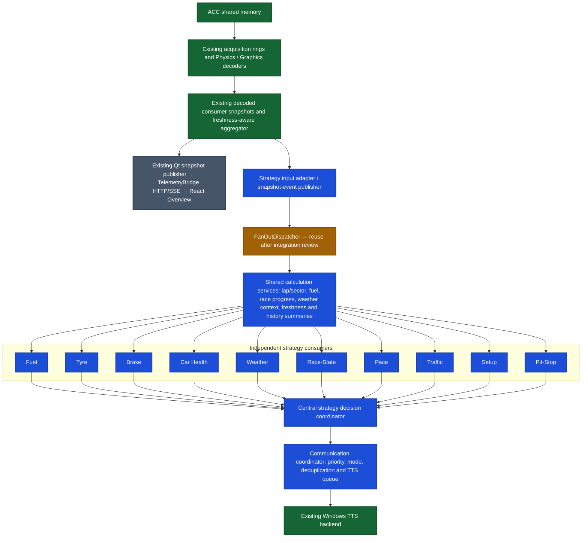

# ACC Race Engineer — Strategy Consumer Architecture

**Repository:** AbhilashHalappa/Race-Engineer-ACC-New  
**Target branch:** feature/race-engineer-page  
**Decision date:** 2026-11-13  
**Status:** Agreed architectural design; implementation and performance validation pending  
**Related documents:** [Telemetry Audit and Development Roadmap](RACE_ENGINEER_TELEMETRY_AUDIT_AND_ROADMAP.md), [Shared Telemetry Requirements Matrix](RACE_ENGINEER_SHARED_TELEMETRY_REQUIREMENTS_MATRIX.md)

## 1. Purpose

Define the additional processing and distribution layers required to run the ten Race Engineer strategy consumers efficiently on top of the existing ACC telemetry pipeline.

The design is informed by a reference review of RaceIQ and Pro Engineer. It adopts the useful architectural principles—one acquisition path, shared computation, separation of live state from history, non-blocking consumers and measurement-driven performance work—without copying either project's implementation.

The primary performance requirement is to add strategy analysis without creating another ACC shared-memory reader, duplicating high-frequency telemetry acquisition, adding unnecessary polling loops, or putting strategy work on the existing Overview publishing/rendering path.

## 2. Decisions

1. **The existing Overview page and its publishing path remain untouched.** Do not redesign or route Overview through the strategy dispatcher. Preserve the current Qt snapshot publisher, TelemetryBridge HTTP/SSE transport and React Overview consumer.
2. **Reuse existing ACC acquisition and decoded Physics/Graphics consumer snapshots.** No strategy may open a shared-memory mapping, create a second reader, drain acquisition rings, or take ownership of another consumer's queue.
3. **Add a strategy-only distribution boundary.** It receives reusable decoded state and meaningful domain events, then distributes them to independent strategy consumers. It is separate from Overview's UI transport.
4. **Use two delivery classes.** Latest-value snapshots are coalescible: consumers need the newest state, not every intermediate sample. Meaningful events are identified and gap-detectable; history-critical events require stronger delivery/reconciliation than replaceable live snapshots.
5. **Reuse and integrate the existing `FanOutDispatcher` where it meets the contract.** The component exists in `src/race_engineer_acquisition/fanout.py`, but the source audit found it is not instantiated or connected to the current live runtime. Do not create a competing dispatcher before reviewing its queue, worker and failure semantics.
6. **Do not create one high-frequency polling loop or one dedicated thread per strategy by default.** Prefer event-triggered evaluation and a bounded shared execution/scheduling facility, with independent bounded mailboxes and fair service. Confirm the existing dispatcher's actual threading model before selecting the integration.
7. **Calculate common domain values once.** Shared calculations have a single owner and publish immutable results with source sequence/timestamp and freshness metadata. Strategies consume these results rather than reimplementing them.
8. **Separate strategy evaluation from final decision and speech.** Specialist strategies emit evidence and recommendations. A central decision coordinator resolves conflicts; Pit-Stop Strategy remains the only routine pit-recommendation authority. A separate communication coordinator prioritises, deduplicates and serialises messages to the existing TTS backend.
9. **Keep history compact and off the acquisition path.** Store lap/session summaries and meaningful events asynchronously. Do not persist duplicate high-frequency raw telemetry merely to support strategy history.
10. **Measure overhead before and after integration.** Establish a baseline and measure CPU, memory, queue depth/age, event latency and acquisition/Overview stability. Do not assume an external project's published CPU figure applies to this application.

## 3. Colour legend

The diagrams use the following status colours:

- **Green — existing:** present in the audited implementation and reused.
- **Grey — preserve unchanged:** existing Overview-only path; explicitly outside this change.
- **Yellow — existing but not integrated:** code exists, but it is not connected to the live strategy runtime.
- **Blue — new or to be extended:** required design layer; implementation remains pending.

## 4. Target architecture

The Overview and strategy branches share the existing decoded data source but remain separate after that boundary. The Overview path must not depend on strategy queue health, calculations, storage, decisions or TTS.

## 5. Layer responsibilities and implementation status

| Layer | Status | Responsibility / decision |
|---|---|---|
| ACC acquisition and rings | Existing — green | One read path per ACC source stream. |
| Physics / Graphics decoders and consumers | Existing — green | Decode once; retain latest good decoded snapshots and health. |
| Engineering snapshot aggregator | Existing foundation — green | Reuse freshness-aware snapshots and stream metadata; do not assume Physics/Graphics are synchronised. |
| Overview publisher and TelemetryBridge | Preserve unchanged — grey | Continue existing Qt → bridge → HTTP/SSE → React path. No strategy processing is inserted into this path. |
| Strategy input adapter / publisher | New — blue | Adapt existing decoded state into strategy snapshot updates and identified domain events without taking ownership of acquisition queues. |
| Fan-out dispatcher | Exists but not integrated — yellow | Review and connect `src/race_engineer_acquisition/fanout.py` if its semantics satisfy this design. |
| Shared calculation services | New / extend — blue | Own common calculations once and publish reusable results. |
| Strategy consumers | New — blue | Independently evaluate specialist evidence and emit typed outputs. |
| Decision coordinator | New — blue | Combine strategy outputs, apply precedence and produce a coherent recommendation set. |
| Communication coordinator | New — blue | Apply communication modes, priorities, critical-warning bypass, deduplication and TTS serialisation. |
| Compact strategy history | New / existing storage audit required — blue | Persist important events and lap/session summaries asynchronously, with provenance. |

## 6. Strategy input contract

### 6.1 Latest-value snapshots

A snapshot represents the newest known decoded state for a source or a composed view. It should contain, where available:

- Source identity (Physics, Graphics or Static).
- Source capture timestamp, packet/capture sequence and ACC packet ID.
- Process-local receive/monotonic timestamp where needed for age calculations.
- Stream and decoder lifecycle/health.
- Per-source freshness and validity state.
- Typed decoded values, preserving raw values where interpretation is not validated.
- Cross-stream skew/compatibility metadata when a calculation combines independent streams.

Snapshots are immutable after publication. A consumer must not mutate shared state. A stale last-good value may remain available for diagnostics but must not be treated as current evidence.

### 6.2 Meaningful events

Events represent transitions that strategies or history must not silently miss. Initial event families:

- Completed lap and sector transition.
- Lap validity result.
- Pit entry, pit exit and observed pit-service state transitions.
- Session start/end/change and reconnect/reset.
- Damage-channel change and observed repair/reset transition.
- Weather/track-condition transition and forecast update.
- Position/gap transition where the source semantics have been validated.
- Setup recommendation and driver-confirmed setting change.
- Strategy recommendation, decision change and driver-confirmed action.

Every event should carry a stable event type, session identity, monotonic event identity/sequence, source timestamps, relevant source sequence references, evidence/provenance and payload schema version. Events derived from unvalidated fields must retain candidate status and cannot be promoted into hard constraints.

### 6.3 Delivery policy

| Data class | Delivery policy | Backlog policy |
|---|---|---|
| High-rate live values | Latest-value / coalescing | Replace obsolete pending state with newest state. |
| Lap and sector events | Identified, ordered, gap-detectable | Do not silently drop; detect gaps and reconcile from authoritative lap/session state. |
| Pit/session/damage/weather transitions | Identified and deduplicated | Preserve or reconcile; record sequence gaps and recover from current snapshot/history. |
| Strategy outputs | Typed, versioned and attributable | Supersede obsolete pending recommendations while retaining decision history. |
| Radio messages | Central priority queue | Deduplicate; critical warnings have priority and cannot be blocked by routine chatter. |

A bounded queue is mandatory. “Reliable” does not mean unbounded memory: it means explicit event identity, gap detection, reconciliation/replay where available, and visible failure state if recovery is impossible. Acquisition must never wait for a downstream consumer or storage write.

## 7. Strategy consumer execution model

- Each strategy registers as an independent consumer with an explicit subscription to the data families and event types it needs.
- Each consumer has bounded pending state and its own processing/failure metrics.
- Live snapshots are coalesced; a consumer should normally process the newest useful state rather than every obsolete sample.
- Event-triggered evaluation is preferred over repeated polling. Examples include completed-lap evaluation, pit transitions, session changes, damage changes and weather transitions.
- Continuous monitoring is allowed only where justified by a real-time warning requirement. It must use the latest shared snapshot, a controlled cadence and cheap checks; it must not create a new ACC reader.
- Do not default to ten independent high-frequency worker threads. Use a bounded shared scheduler/worker pool or the existing dispatcher model after confirming its actual threading behaviour. A long-running consumer must not monopolise the shared execution facility.
- Consumer exceptions, timeouts or slow processing must be isolated. One strategy must not block acquisition, Overview publishing, another strategy or the radio coordinator.
- Consumers must be restartable and able to initialise from the latest snapshot plus recoverable event sequence.
- Shutdown must be bounded and must not wait indefinitely for a strategy or storage operation.

### Initial event-to-strategy routing

| Event / data family | Primary consumers |
|---|---|
| Completed valid lap, lap time and sector summary | Fuel, Tyre, Brake, Pace, Race-State, Setup, Pit-Stop |
| Live fuel and fuel-consumption observation | Fuel, Pit-Stop |
| Four-corner tyre pressure/core temperature and stint context | Tyre, Pit-Stop, Weather (context only) |
| Brake temperature and validated pad/disc observations | Brake, Pit-Stop |
| General damage and mechanical warning observations | Car Health, Pit-Stop |
| Current weather and forecast progression | Weather, Tyre, Setup, Pit-Stop |
| Session state, time, flags and validated race-control data | Race-State, Fuel, Pace, Traffic, Pit-Stop |
| Opponent gaps, positions and nearby-car context | Pace, Traffic, Pit-Stop (timing context only) |
| Setup state and driver-confirmed adjustment | Setup, Pace, Tyre, Brake |
| Pit entry/exit and confirmed service evidence | Fuel, Tyre, Brake, Car Health, Race-State, Pit-Stop |

The table is an initial subscription map, not permission to use unvalidated fields. Each strategy must still enforce its documented field-validation and freshness gates.

## 8. Shared calculation services

Common calculations must have one owner, a defined input contract and a versioned result. Candidate shared services:

- Lap/sector normalisation, lap validity and completed-lap event generation.
- Rolling valid-lap pace and consistency summaries.
- Race progress and session-time interpretation, subject to validated race-state semantics.
- Fuel observations and, once release gates pass, fuel projections.
- Tyre stint context and pressure/temperature trend summaries.
- Brake temperature/trend summaries.
- Damage-change and repair-transition observations.
- Weather observation/forecast timeline and transition detection.
- Opponent identity, gap and relative-context normalisation, only after source semantics are validated.
- Setup version and before/after comparison context.
- Pit event and service history.

Results should include calculation version, input source sequence/timestamps, freshness, evidence class (measured/calculated/inferred), and validation state. Do not calculate the same rolling average independently inside Fuel, Pace and Pit-Stop.

## 9. Decision and communication boundaries

### 9.1 Strategy output contract

A strategy emits a typed observation, warning or recommendation, not direct speech or an ACC action. At minimum, an output should carry:

- Strategy owner and output type.
- Session/event identity and creation timestamp.
- Severity/priority where applicable.
- Evidence class: measured, calculated or inferred.
- Supporting observations and source references.
- Freshness/validation state and confidence/limitations.
- Valid-until or supersession information.
- Whether it is informational, actionable or a specialist critical warning.

### 9.2 Central decision coordinator

The coordinator:

- Resolves conflicting or duplicated recommendations.
- Applies explicit hard constraints before weighted assessments.
- Combines compatible services into one pit plan.
- Preserves the agreed fixed initial Pit-Stop weights: Fuel 25%, Tyres 25%, Car Health 20%, Brakes 15%, Weather 10%, Race-State strategic context 5%.
- Keeps Pace and Traffic as timing context, not independent pit-necessity weights.
- Treats missing, stale, candidate or unvalidated evidence as unknown; never silently converts it to zero or redistributes weights.
- Leaves specialist critical informational warnings available even when routine recommendations are consolidated.
- Does not control ACC. The driver manually performs every action.

Pit-Stop Strategy is the sole owner of routine pit recommendations. Other strategies must not issue competing routine “pit now” instructions.

### 9.3 Communication coordinator

Only the communication coordinator submits messages to the existing TTS backend. It owns:

- Driver-initiated, Balanced and Active modes, switchable during a session.
- Critical-warning bypass in all modes.
- Priority ordering, deduplication, escalation and resolution.
- Non-critical mute/resume and repeat-last-message.
- Short radio messages and detailed on-request explanations.
- Serial TTS output and failure handling.

Strategy workers must never call TTS directly. TTS latency must not block strategy evaluation or telemetry acquisition.

## 10. Compact history and persistence

- Persist completed-lap summaries, meaningful state transitions, pit events, strategy outputs/decisions, driver confirmations and post-action outcomes.
- Preserve provenance: automatically observed, calculated, inferred, imported or driver-confirmed.
- Store only the fields needed to explain and compare decisions; avoid duplicating the full high-frequency telemetry stream.
- Use an asynchronous bounded persistence path, separate from acquisition and strategy execution.
- If storage falls behind, expose backlog/failure metrics and apply an explicit retention/reconciliation policy. Never block acquisition.
- Preserve session identity, event sequence, timestamps and schema versions so records can be reconciled after reconnects or application restarts.
- Reuse existing session/history facilities where they meet these requirements; audit current pit/session storage APIs before adding a new store.

## 11. Resource and performance safeguards

### 11.1 Prohibited patterns

- Additional Physics/Graphics/Static shared-memory readers for individual strategies.
- Strategies destructively reading or draining acquisition rings.
- One independent high-frequency polling loop per strategy.
- Unbounded per-consumer queues or unbounded history buffers.
- Repeated full-history scans during live telemetry processing.
- Duplicate calculation of shared rolling statistics.
- Blocking acquisition, decoder publication, Overview publishing or the UI thread on strategy work, TTS or disk I/O.
- Strategy processing inserted into the Overview bridge or React update path.

### 11.2 Required measurements

Capture a baseline before enabling strategy consumers, then compare at each integration stage:

- Process CPU: average and peak over repeatable idle, practice and race workloads.
- Process memory: steady-state and peak resident memory.
- Acquisition and decoder update cadence, sample age and error/drop counts.
- Strategy dispatcher queue depth, oldest-item age, coalesced snapshots, event gaps and consumer processing duration.
- Shared calculation duration and cache/reuse effectiveness.
- Event-to-decision latency and decision-to-radio queue latency.
- Persistence backlog and write latency.
- Overview snapshot publication cadence, SSE delivery behaviour and UI responsiveness.
- Recovery after a deliberately slow/failing consumer and after reconnect/session transition.

Use repeatable ACC recordings or deterministic replay for comparable workloads. Compare the same car/track/session and consumer set. Define numeric budgets only after measuring the baseline and agreeing acceptable tolerances; do not borrow CPU percentages from other products.

### 11.3 Acceptance criteria

- No additional ACC shared-memory reader is introduced.
- Overview code and publishing behaviour are unchanged by this architecture work.
- A slow, failed or restarted strategy cannot block acquisition, Overview or other consumers.
- Live snapshots coalesce instead of accumulating stale backlog.
- History-critical event gaps are detected and reconciled or surfaced explicitly.
- Shared calculations are produced once and reused.
- Memory remains bounded during long sessions and consumer failure.
- CPU, memory, latency and Overview responsiveness remain within agreed measured budgets.
- All outputs remain advisory and read-only with respect to ACC.

## 12. Integration and implementation sequence

1. **Complete the source/API audit.** Verify decoder consumer publication semantics, timestamps/sequences, lifecycle, existing service cadence, dispatcher worker model, event producers and storage APIs. Do not assume a push hook exists until source confirms it.
2. **Define typed contracts.** Finalise snapshot, event, strategy-output, error and metrics schemas, including versioning and session identity.
3. **Integrate strategy input publication.** Attach to an existing decoded publication/service boundary without changing the Overview route or adding an independent high-frequency poller. If the current API has no safe notification boundary, design the smallest isolated adapter and measure it.
4. **Integrate or adapt FanOutDispatcher.** Verify bounded queues, worker count, fairness, event ordering/gap handling, coalescing and failure isolation. Extend it only where a concrete contract gap exists.
5. **Implement shared calculations.** Start with lap/session events and the common values needed by multiple strategies.
6. **Add consumers incrementally.** Begin with low-cost observation consumers; add more expensive analysis only after profiling.
7. **Add compact history and recovery.** Verify event reconciliation, session boundaries and persistence isolation.
8. **Add central decision and communication coordinators.** Reuse existing TTS and preserve the agreed radio modes and Pit-Stop ownership.
9. **Benchmark and validate.** Run unit/integration/replay tests, Windows production build and live ACC tests. Compare with the baseline and verify Overview remains unaffected.

## 13. Current source-audit facts and open questions

### Verified in the current branch audit

- `create_acc_acquisition_runtime()` creates independent Physics, Graphics and Static rings.
- Physics and Graphics decoder consumers read their respective rings and expose latest decoded snapshots.
- `RaceEngineerSnapshotAggregator` reads existing Physics/Graphics consumer snapshots and acquisition health; it does not read shared memory or drain acquisition queues.
- The Qt host currently publishes the Overview snapshot on its existing timer through `TelemetryBridge`; this is the path to preserve.
- Static is currently acquired raw; the Qt host drains the Static ring and decodes candidate metadata in its identity-refresh path.
- `src/race_engineer_acquisition/fanout.py` implements a dispatcher with bounded consumer queues and failure/processing metrics, and tests exist for its isolated behaviour.
- The audited live runtime does not instantiate that dispatcher, register strategy consumers or start a strategy fan-out worker.
- The existing Overview HTTP/SSE path distributes UI snapshots to connected clients; it is not a general strategy-consumer event bus.
- The current Race Engineer service is an early observation foundation, not a complete strategy engine or central communication system.

### Must be verified before implementation

- Whether Physics/Graphics consumer publication can safely notify a strategy adapter without adding meaningful work to decoder threads.
- Exact ownership and lifecycle boundary for a strategy-only publisher.
- Whether dispatcher workers are per-consumer or shared, and whether its queue semantics support latest-value coalescing separately from history-critical events.
- Whether dispatcher acknowledgements and error handling can be made non-blocking for acquisition and other consumers.
- Existing event identity, lap/pit/session history and persistence APIs.
- Exact current Race Engineer service update cadence and whether it can be reused without coupling to Overview's 50 ms publisher.
- Whether a small shared scheduler is needed in addition to the existing dispatcher, and the measured cost of either approach.

## 14. Explicit non-goals

- No redesign, refactor or performance changes to the Overview page or its Qt/HTTP/SSE/React pipeline.
- No second ACC shared-memory reader or alternate telemetry acquisition system.
- No automatic ACC/game control, MFD operation, setup application, pit action, fuel/tyre change or driving input.
- No unconditional per-strategy threads, high-frequency polling loops or unbounded queues.
- No high-frequency duplicate raw telemetry recording for strategy history.
- No automatic learning or adaptation of the agreed Pit-Stop weights.
- No claim that this design is implemented, benchmarked or live-validated merely because the design is documented.

## 15. Change log

- **2026-11-13:** Initial architecture decision documented. Overview pipeline explicitly frozen; strategy-only snapshot/event distribution, dispatcher integration, shared calculations, independent consumers, central decision/communication coordination, compact history and performance measurement defined. No application code changed.
